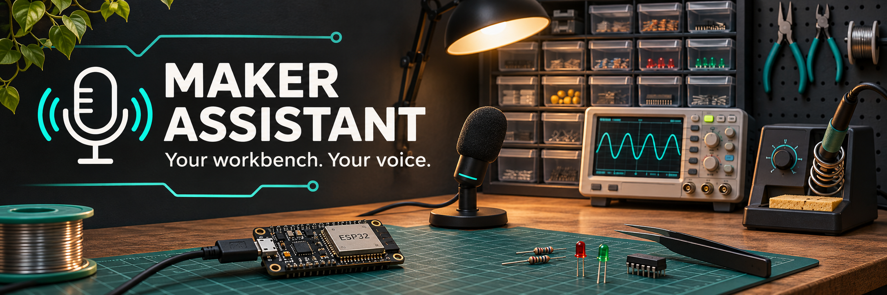

<p align="center"></p>

# Maker Assistant

**Find components, record what you take, and set timers by voice.**

English · [Русский](README.ru.md)

[](https://github.com/darkvolg/maker-assistant/actions/workflows/tests.yml)
[](https://www.python.org/)
[](LICENSE)

An early electronics workbench prototype, built with AI assistance. Local speech recognition with faster-whisper, offline Windows speech with SAPI, SQLite inventory, and optional conversation through Ollama. No account or paid API is required for the local configuration. Initial dependency and model downloads require internet.

**Looking for people willing to try it at a real bench.** Microphone quality, accents and workshop noise still need field testing. This is not a general-purpose autonomous assistant or a complete inventory management system.

## What it does

- Search by component name, value and package, including `10k 0805`.
- Keep quantities and a consumption journal in SQLite. Confirm before changing stock; undo the last consumption.
- Remember the last uniquely selected component: `find ESP32` → `take two` → `confirm`.
- Announce timers and the current time.
- Recognize English or Russian, using separate configuration profiles.
- Optionally control allowlisted Home Assistant entities or use Git/GitHub tools. These are disabled by default and are not fully localized into English.

Basic commands use deterministic handlers and work without an LLM. Flexible requests go to the configured model; tool calls are validated and changes require confirmation. The model can still misunderstand a request. It is never the inventory database.

## English quick start — Windows

Install Python 3.10+ and optionally [Ollama](https://ollama.com/) for conversation. A microphone and an installed English Windows SAPI voice are needed for voice mode. The English profile selects **Microsoft David**; choose another installed English voice if needed. An NVIDIA GPU is optional.

```powershell
git clone https://github.com/darkvolg/maker-assistant.git
cd maker-assistant
python -m venv .venv
.venv\Scripts\python.exe -m pip install -e .
.venv\Scripts\python.exe main.py download-model --config-file config.en.yaml
ollama pull qwen2.5:7b-instruct
.venv\Scripts\python.exe main.py import-inventory examples/inventory.en.json --config-file config.en.yaml
.venv\Scripts\python.exe main.py doctor --config-file config.en.yaml --audio-test --stt-test
.venv\Scripts\python.exe main.py chat --config-file config.en.yaml
```

The import creates **sample stock**, not a record of your actual parts. Import your own JSON into an empty database using the same format. Importing into an occupied database is refused.

Then open **`run-english.bat`**, or run:

```powershell
.venv\Scripts\python.exe main.py listen --config-file config.en.yaml
```

For deterministic commands without Ollama, set `brain.provider: none` in your local profile and skip `ollama pull`. Qwen is already multilingual; switching language does not require downloading a separate English LLM.

## Example

Say the wake word before **every** command, including confirmation:

```text
You: Jarvis, find ten k resistors.
Assistant: 10k resistor (SMD 0805): 150 pcs, Reel R-10K.
You: Jarvis, take four.
Assistant: Take components. count: 4, project: current project. Say "confirm" to proceed or "cancel" to stop.
You: Jarvis, confirm.
Assistant: Taken 4 pcs of 10k resistor. Remaining: 146.
You: Jarvis, undo.
Assistant: Undo the last consumption. Say "confirm" to proceed or "cancel" to stop.
You: Jarvis, confirm.
Assistant: Consumption undone. Restored 4 pcs.
```

Also try `Jarvis, set a timer for five minutes`, `Jarvis, what time is it`, or `Jarvis, do we have ESP32`.
In text chat omit `Jarvis`. `cancel` clears the pending action; `undo` proposes reversing the last consumption and needs confirmation. A confirmation expires after 45 seconds. A new request replaces the previous pending action.

## Configuration and privacy

| Profile | Machine overrides (ignored by Git) | Default inventory |
| --- | --- | --- |
| `config.en.yaml` — English | `config.en.local.yaml` | `data/inventory.en.sqlite3` |
| `config.yaml` — Russian | `config.local.yaml` | `data/inventory.sqlite3` |

Paths are relative to the configuration file. Profiles do not share overrides or inventory by default. Existing Russian users can keep using `run.bat` unchanged. Inventory names and locations are user data and are not automatically translated.

Example `config.en.local.yaml`:

```yaml
tts:
  sapi_voice: Zira
audio:
  input_device: null  # Current Windows input, including redirected RDP audio
```

- Whisper `small` defaults to CPU/int8 with cached models only. Ollama defaults to localhost. SAPI runs on Windows. These components can run without internet after installation.
- `tts.engine: console` provides text output, including on Linux/macOS. `chat --mute` also avoids speech.
- **`tts.engine: edge-tts` uses an online service and sends text to it.** It is optional; an error falls back to SAPI. There is no automatic cloud LLM fallback.
- `voice-settings.bat` opens an optional local voice audition panel. The panel includes online Edge voices and can contact that service to list or preview them. Its saved profiles are drafts; they do not change the assistant configuration. The panel is currently in Russian.
- Use `main.py devices` to list microphones; `listen --config-file config.en.yaml --microphone fifine` selects a matching device. Device indices can change after reconnecting.
- In RDP, enable microphone and speaker redirection. Playback uses the current Windows output.
- CUDA is optional: set `stt.device: cuda` and `compute_type: float16` with compatible CUDA/cuDNN libraries. Loading or recognition errors trigger a CPU retry.

Optional Home Assistant integration requires a URL, an explicit `allowed_entities` list, and `HA_ACCESS_TOKEN` in `.env`. Git uses a fixed configured repository and commits only files you staged yourself; a failed commit prevents push. GitHub issues require authenticated `gh`. See the [Russian integration reference](README.ru.md#дополнительные-интеграции).

## Current limits

- Keep the process open. Timers are lost on exit; at most 20 timers, each up to 24 hours.
- Wake detection runs on transcribed speech, not on a dedicated wake-word model. Utterances are limited to 15 seconds. You cannot interrupt processing or speech playback.
- Speech starts based on an energy threshold. Extractor fans and other workshop noise can interfere; tune `audio.energy_threshold` for your setup.
- Core English inventory, confirmation, clock and timer responses are localized. Some CLI help, diagnostics, the voice panel and optional integrations still contain Russian.
- Windows SAPI is the integrated offline voice engine. Piper/Silero experiments are not part of the supported runtime.
- Voice confirmation is not authentication. Home Assistant command acceptance is not a physical measurement of a device's state.

## Validation and development

```powershell
.venv\Scripts\python.exe -m pip install -e ".[dev]"
.venv\Scripts\python.exe -m pytest -q
```

Tests cover inventory transactions, confirmation/cancellation/expiry, undo, English command routing, timer language, profile isolation, audio handling and the voice panel. CI targets Windows/Linux on Python 3.10/3.13; this does not establish physical audio compatibility on every OS.

On Windows, with cached Whisper `small` and SAPI Irina/David, run the opt-in speech integration test:

```powershell
$env:MAKER_TEST_VOICE="1"
.venv\Scripts\python.exe -m pytest tests/test_voice_integration.py -q -s
Remove-Item Env:MAKER_TEST_VOICE
```

This synthesizes five phrases in each language, transcribes them with real Whisper, executes the commands on temporary stock, and checks the result. **Synthetic speech testing is not evidence of accuracy with human voices or workshop noise.**

See [examples/custom_skill.py](examples/custom_skill.py) for adding a skill. Register side-effecting actions with `mutating=True`.

## Background

Inspired by [disler/always-on-ai-assistant](https://github.com/disler/always-on-ai-assistant). This project focuses on electronics inventory, confirmation and undo. It does not claim to outperform the original or replace mature tools.

MIT — [LICENSE](LICENSE). Artwork was generated with AI and is illustrative, not a product screenshot.
