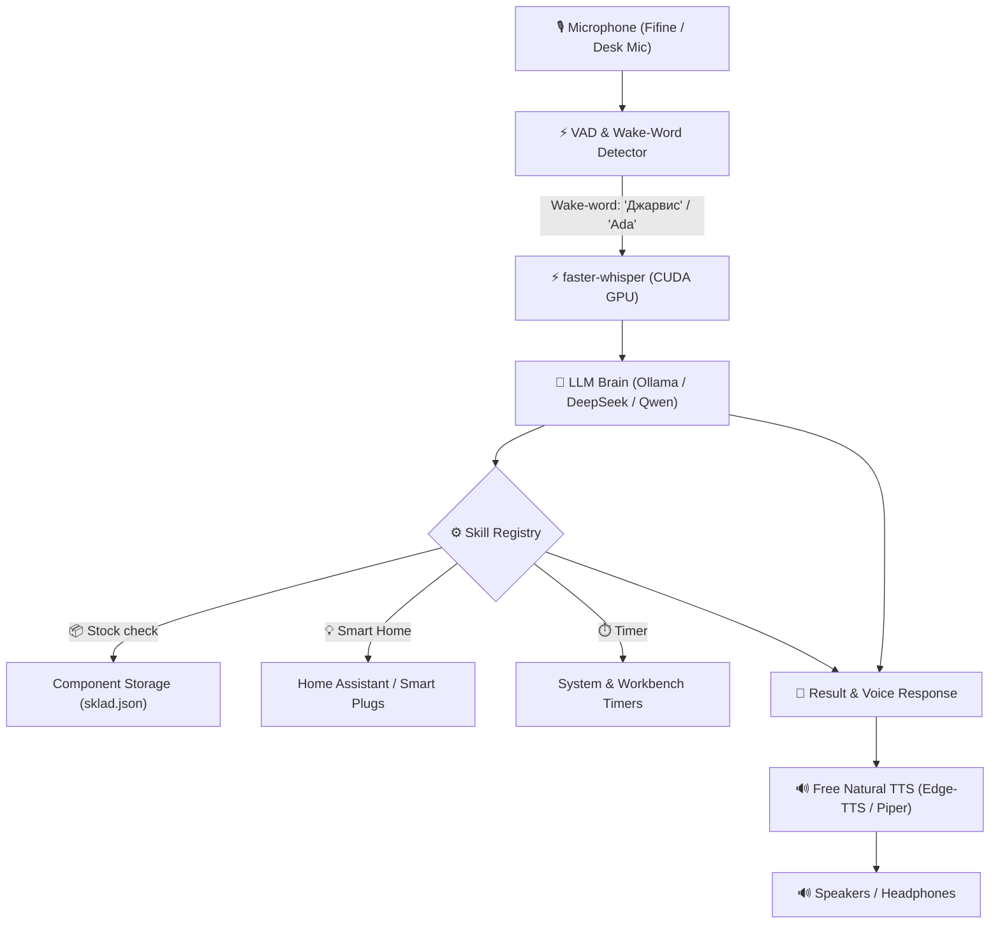

# 🛠️ Maker Assistant (Always-On Voice AI)

> **100% Local, Always-On Voice AI Assistant tailored for Hardware Engineers, Makers & Coders.**  
> Hands-free workbench assistant: search components in stock, manage smart devices, run timers, and control your lab — without touching keyboard or mouse.

[](https://www.python.org/)
[](https://opensource.org/licenses/MIT)
[](https://developer.nvidia.com/cuda-toolkit)
[](#)
[](#)

---

## ⚡ Why Maker Assistant?

When soldering, holding oscilloscope probes, or assembling circuits, **your hands are busy**. 

Other voice assistants (like `disler/always-on-ai-assistant`) charge monthly subscriptions for **ElevenLabs** and external LLMs, have no built-in maker skills, and only run mock commands. 

**Maker Assistant** is built differently:
- 🚀 **100% Free & Local-First:** Powered by `faster-whisper` on GPU (CUDA), free natural TTS, and local LLMs (Ollama) or optional API.
- ⚡ **Low Latency:** ~1 second speech transcription with GPU acceleration.
- 🧰 **Real Maker Skills:**
  - 📦 **Stock & Components Search:** "Do we have 10k 0805 resistors?" → *"Yes, 150 pcs in reel R-10K."*
  - 📝 **Live Component Consumption:** "Deduct 2 ESP32 modules for current project" → Auto-updates storage database.
  - ⏱️ **Lab Timers:** PCB cooling, acid etching, curing timers.
  - 💡 **Smart Lab & Devices:** Home Assistant, Smart sockets, TV/monitor control.
- 🔌 **Extensible in 5 Lines:** Adding a new skill takes one Python decorator.

---

## 📊 Comparison with Alternatives

| Feature | `disler/always-on-ai-assistant` | 🛠️ **Maker Assistant** |
|:---|:---:|:---:|
| **TTS Cost** | 💸 Expensive (ElevenLabs API) | 🟢 **100% Free** (Edge-TTS / Local) |
| **STT Latency** | Cloud/CPU (~2-4s) | ⚡ **~1s on GPU (CUDA faster-whisper)** |
| **Hardware / Lab Skills** | ❌ None (Mock SQLite only) | ✅ **Electronics Stock, Lab Tools, HA** |
| **Multilingual (RU / EN)** | ⚠️ English only | 🌐 **Full Russian & English Support** |
| **Privacy** | ☁️ Sends audio/text to cloud | 🔒 **100% Local option available** |

---

## 🏗️ Architecture



---

## 🚀 Quick Start (60 Seconds)

### 1. Clone & Install
```bash
git clone https://github.com/darkvolg/maker-assistant.git
cd maker-assistant

# Install dependencies
pip install -r requirements.txt
```

*(Optional for GPU acceleration)*: Ensure NVIDIA CUDA 12.x drivers are installed on your system.

### 2. Configure
Copy `.env.example` to `.env`:
```bash
cp .env.example .env
```
*(Optional)* Add your Home Assistant URL/Token or DeepSeek API Key if you want cloud fallback.

### 3. Run
On Windows:
```cmd
run.bat
```
Or directly via CLI:
```bash
# 1. Hands-Free Always-On Voice Mode:
python main.py listen

# 2. Text Console Chat Mode (Test without microphone):
python main.py chat
```

---

## 🔌 Adding Custom Skills

Create your own action in 5 lines of code:

```python
from assistant.skills.registry import registry

@registry.register("toggle_soldering_iron", "Turn workbench soldering iron socket on or off.")
def toggle_soldering_iron(state: str) -> str:
    # Trigger smart plug via MQTT, Tuya, or Home Assistant
    return f"Soldering iron is now {state}."
```

---

## 📦 Project Structure

```
maker-assistant/
├── assistant/
│   ├── core/
│   │   ├── stt.py         # faster-whisper GPU engine
│   │   ├── wake_word.py   # Continuous wake-word listener
│   │   ├── brain.py       # LLM decision making & JSON tool calling
│   │   └── tts.py         # Free natural voice synthesis
│   ├── skills/
│   │   ├── registry.py    # Decorator & dispatcher for skills
│   │   ├── components.py  # Electronic components stock manager
│   │   ├── smart_home.py  # Home Assistant & TV integrations
│   │   └── system_tools.py# Timers & system utilities
│   └── utils/
│       └── audio.py       # Audio recording & chime feedback
├── examples/
│   ├── sklad_example.json # Example electronic inventory
│   └── custom_skill.py    # How to write custom skills
├── config.yaml            # Main configuration file
├── run.bat                # Windows 1-click launcher
├── requirements.txt       # Dependencies
└── main.py                # Entrypoint
```

---

## 📄 License

MIT License. Free for personal and commercial use. Contributions and PRs are welcome!
