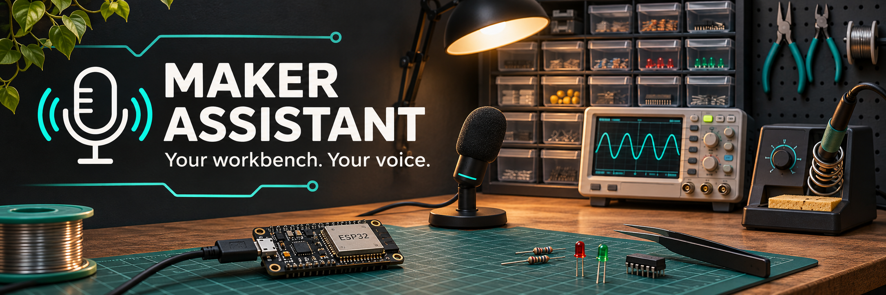

<p align="center"></p>

# Maker Assistant

[English](README.md) · Русский

**Голосовой помощник для мастерской: найти деталь, записать расход, поставить таймер.**

Hands-free electronics inventory, timers and optional Home Assistant / Git integrations.
Local speech recognition with faster-whisper; offline Windows speech with SAPI; optional Ollama conversation.

[](https://github.com/darkvolg/maker-assistant/actions/workflows/tests.yml)
[](https://www.python.org/)
[](LICENSE)

**Статус: 0.2, ранняя версия для испытаний в мастерской.** Основной сценарий и Windows-окружение проверены локально. Работа в шуме, разные микрофоны и другие ОС требуют полевых проверок. Нет обещания универсальной точности или секундной установки.

## Что работает

- Поиск деталей по названию, номиналу и корпусу: `10k 0805` и `10 кОм 0805`.
- SQLite-склад, проверка остатка, журнал списаний и отмена. Пример JSON не изменяется.
- Контекст выбранной детали: «найди ESP32» → «взял два» → «подтверждаю».
- Таймеры с голосовым уведомлением, время и дата.
- Голосовая команда целиком: «Джарвис, найди ESP32». Можно назвать имя отдельно и произнести команду после ответа «Слушаю».
- Выбор текущего микрофона Windows или конкретного устройства, включая Fifine и удалённый рабочий стол.
- Опционально: включение / выключение разрешённых устройств Home Assistant; Git status, commit подготовленных файлов + push, создание Issue.

Изменение склада, устройства, commit/push и Issue сначала предлагаются к подтверждению. «Подтверждаю» выполняет одну ожидающую команду, «отмена» отменяет её. Подтверждение истекает через 45 секунд; новый запрос заменяет предыдущую команду. В голосовом режиме каждую фразу начинайте с имени ассистента.

## Быстрый запуск на Windows

Нужны Python 3.10+, микрофон и, для свободного диалога, [Ollama](https://ollama.com/).
Первичная установка зависимостей и моделей требует интернета. NVIDIA необязательна.

```powershell
git clone https://github.com/darkvolg/maker-assistant.git
cd maker-assistant
python -m venv .venv
.venv\Scripts\python.exe -m pip install -e .
.venv\Scripts\python.exe main.py download-model
ollama pull qwen2.5:7b-instruct
.venv\Scripts\python.exe main.py import-inventory examples/sklad_example.json
.venv\Scripts\python.exe main.py doctor --audio-test --stt-test
.venv\Scripts\python.exe main.py chat
```

Импорт выше создаёт **демонстрационный** склад из пяти позиций, а не проверяет ваши реальные запасы. Для своего склада подготовьте JSON по примеру и импортируйте в пустую базу, задав другой `storage_path`. Повторный импорт в заполненную базу отклоняется.

После установки откройте `run.bat`: голос, чат, диагностика, обновление зависимостей или импорт примера. Пункт 1 использует текущий микрофон Windows, пункт 6 — Fifine.

```powershell
.venv\Scripts\python.exe main.py listen
.venv\Scripts\python.exe main.py listen --microphone fifine
.venv\Scripts\python.exe main.py devices
.venv\Scripts\python.exe main.py test-voice
.venv\Scripts\python.exe main.py chat --mute
```

Можно указать индекс из `devices`: `listen --microphone 12`. Индексы меняются при переподключении, поэтому имя предпочтительнее. Озвучка использует текущий выход Windows; в удалённой сессии настройте перенаправление микрофона и динамиков в RDP.

## Пример разговора

```text
Вы: Джарвис, найди резисторы 10 кОм 0805.
Ассистент: Резистор 10 кОм (SMD 0805): 150 шт., Лента R-10K ...
Вы: Джарвис, взял четыре.
Ассистент: Списать детали. Количество: 4 ... Подтверди ...
Вы: Джарвис, подтверждаю.
Ассистент: Списано 4 шт. Резистор 10 кОм. Осталось 146.
Вы: Джарвис, отмени.
Ассистент: Вернуть последнее списание ... Подтверди ...
Вы: Джарвис, подтверждаю.
Ассистент: Списание отменено. Возвращено 4 шт.
```

Точные базовые команды работают без LLM и без сети: «найди ESP32», «взял два», «спиши 2 ESP32», «который час», «таймер на 5 минут», «отмени». Свободные формулировки и разговор требуют доступной модели.

Английский режим: `run-english.bat` или `listen --config-file config.en.yaml`. В нём отдельно заданы язык распознавания, голос David, команды и ответы склада/таймеров. Модель Qwen остаётся той же. Пример склада: `import-inventory examples/inventory.en.json --config-file config.en.yaml`; это отдельная база `data/inventory.en.sqlite3`. Личные настройки: `config.en.local.yaml`. Русский профиль, база и `run.bat` сохранены. Служебная диагностика, панель голосов и дополнительные интеграции пока переведены не полностью.

## Локальность и настройки

`config.yaml` — общие настройки. Неотслеживаемый `config.local.yaml` переопределяет их для конкретного ПК. Пути склада и Git вычисляются относительно файла конфигурации.

По умолчанию Whisper `small` работает на CPU/int8 и читает уже скачанную модель. SAPI озвучивает локально на Windows. Ollama настроена на локальный адрес. После загрузки моделей эти компоненты могут работать без интернета.

- `tts.engine: sapi` — локальная Windows-озвучка, `tts.sapi_voice: Irina`.
- `tts.engine: edge-tts` — интернет-сервис; текст передаётся внешнему сервису. При ошибке пробуется SAPI.
- `tts.engine: console` — только текст, подходит для Linux/macOS без настроенного голоса.
- `brain.provider: none` — только базовые команды, без LLM.
- Для DeepSeek/OpenAI укажите `provider`, `model`, соответствующий `base_url` и ключ в `.env`. Автоматического облачного переключения нет.
- Для CUDA укажите `stt.device: cuda`, `compute_type: float16`. Требуются совместимые CUDA/cuDNN; при ошибке загрузки или распознавания приложение пробует CPU. См. [faster-whisper](https://github.com/SYSTRAN/faster-whisper#gpu).

На проверенном ПК (RTX 3070 8 ГБ, 32 ГБ RAM) выбран CPU для Whisper, чтобы оставить видеопамять Ollama. Распознавание одной синтезированной русской фразы заняло около 1,7 с; это не показатель полной задержки и не испытание в шуме.

## Дополнительные интеграции

По умолчанию Home Assistant и Git отключены. В `config.local.yaml`:

```yaml
skills:
  smart_home:
    enabled: true
    ha_url: http://homeassistant.local:8123
    allowed_entities:
      - light.workbench
  github_tools:
    enabled: true
    repo_path: C:/path/to/your/repository
```

Токен Home Assistant храните в `.env` как `HA_ACCESS_TOKEN=...`; `HA_BASE_URL` при необходимости переопределяет URL. Включать можно только перечисленные `allowed_entities`. Ответ о принятой команде означает успешный HTTP-ответ HA, а не измерение фактического состояния нагрузки. Интеграция не является системой безопасности для нагревателей и оборудования.

Git требует установленного Git и настроенной авторизации. Сначала вручную подготовьте файлы через `git add <files>`: ассистент **не добавляет все файлы автоматически**. При ошибке commit push не запускается. Для Issue нужен `gh auth login`. Репозиторий фиксируется настройкой, модель не выбирает произвольный путь.

## Ограничения

- Это настольный процесс: окно нужно оставить открытым. Таймеры теряются при выходе, поддерживается до 20 таймеров по 24 часа.
- Активация определяется по распознанной фразе, отдельной лёгкой wake-word модели нет. Запись одной фразы ограничена 15 секундами. Во время обработки и озвучки перебивать ассистента нельзя.
- Детектор начала речи использует порог громкости; в шумной мастерской подберите `audio.energy_threshold`. Устойчивость к вытяжке не гарантируется.
- Выбранная деталь хранится в текущем процессе; последнее списание и его отмена — в базе. При нескольких совпадениях требуется уточнение.
- Голосовое подтверждение не является аутентификацией. Не включайте чувствительные интеграции в общем помещении без оценки условий.
- Офлайн-голос SAPI доступен только на Windows. Piper и отдельное управление ТВ без Home Assistant не реализованы.

## Разработка

```powershell
.venv\Scripts\python.exe -m pip install -e ".[dev]"
.venv\Scripts\python.exe -m pytest -q
.venv\Scripts\python.exe -m build --wheel
```

CLI установлен как `maker-assistant`; запускайте из каталога с `config.yaml` или передавайте `--config-file`. Основные файлы: `assistant/cli.py`, `core/brain.py`, `core/stt.py`, `core/tts.py`, `utils/audio.py`, `skills/`. Тесты не обращаются к реальным устройствам или GitHub. CI проверяет Windows/Linux и Python 3.10/3.13; физический звук и модели проверяются отдельно через `doctor`.

На Windows можно повторить проверку пяти аудиофраз на каждом языке настоящей моделью (нужны локальная модель `small` и голоса Irina/David):

```powershell
$env:MAKER_TEST_VOICE="1"
.venv\Scripts\python.exe -m pytest tests/test_voice_integration.py -q
Remove-Item Env:MAKER_TEST_VOICE
```

Пример расширения: [examples/custom_skill.py](examples/custom_skill.py). Импортируйте модуль в `assistant/cli.py`, чтобы декоратор зарегистрировал функцию. Для действий с побочными эффектами обязательно используйте `mutating=True`.

## Происхождение

Вдохновлено [disler/always-on-ai-assistant](https://github.com/disler/always-on-ai-assistant), демонстрирующим архитектуру постоянно доступного голосового агента. Исходный проект также поддерживает локальные компоненты. Здесь акцент на складе радиодеталей, рабочем месте и проверяемых действиях; превосходство по скорости не заявляется.

MIT — [LICENSE](LICENSE). Баннер создан с помощью генерации изображений.
